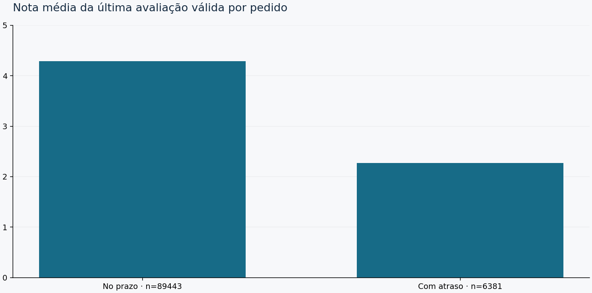
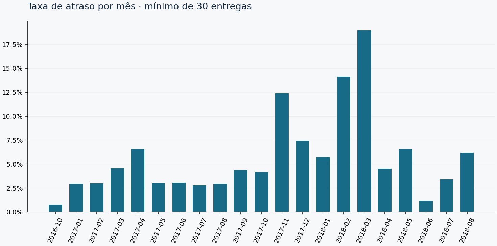

# Onde os atrasos se concentram

Analisei a base histórica da Olist para separar volume de atrasos, proporção de atrasos e experiência do cliente. O snapshot usado está identificado em [DATA_SOURCES.md](../DATA_SOURCES.md). As compras observadas vão de setembro de 2016 a outubro de 2018.

## Visão geral

| Indicador | Resultado |
| --- | ---: |
| Pedidos na base | 99.441 |
| Marcados como entregues | 96.478 |
| Entregas elegíveis | 96.470 |
| Entregues excluídos por falta da data de entrega | 8 |
| Entregas atrasadas | 6.534 |
| Taxa de atraso | 6,77% |
| Tempo médio da compra até a entrega | 12,56 dias |
| Mediana do tempo de entrega | 10,22 dias |
| P90 do tempo de entrega | 23,10 dias |
| Média de dias de atraso, entre atrasados | 10,62 dias |
| Pedidos cancelados | 625 |

A média maior que a mediana e o P90 de 23,10 dias mostram uma cauda de entregas mais longas. Aproximadamente nove em cada dez entregas elegíveis levaram até esse P90. Isso não define um prazo adequado para todas as regiões: os compromissos e as distâncias variam.

## Taxa e volume pedem prioridades diferentes

Alagoas teve a maior taxa de atraso entre os estados com pelo menos 30 entregas elegíveis: **85 de 397, ou 21,41%**. Maranhão veio com 125 de 717, ou 17,43%, e Sergipe com 51 de 335, ou 15,22%.

Em volume, São Paulo concentrou 1.820 atrasos em 40.494 entregas elegíveis, taxa de 4,49%. Rio de Janeiro teve 1.495 atrasos em 12.350 elegíveis, taxa de 12,11%. O Rio respondeu por 22,88% dos atrasos observados.

Eu investigaria o Rio primeiro para combinar relevância de volume com taxa elevada. Em paralelo, examinaria os estados com maiores taxas para entender promessas, rotas e composição dos pedidos. Esses dados não mostram a transportadora nem permitem atribuir responsabilidade operacional.

## Avaliações acompanham o atraso

| Grupo | Entregas elegíveis | Com avaliação válida | Nota média | Notas 1 ou 2 |
| --- | ---: | ---: | ---: | ---: |
| No prazo | 89.936 | 89.443 | 4,29 | 9,27% |
| Com atraso | 6.534 | 6.381 | 2,27 | 62,42% |

A diferença justifica aprofundar a investigação da experiência nos pedidos atrasados. Ela não demonstra causalidade: o atraso pode ocorrer junto com outros problemas, e uma avaliação pode ter sido respondida antes da entrega.

## A série mensal tem variações importantes

Os grupos são por mês de compra, sem ajuste sazonal. Há picos visíveis no fim de 2017 e no início de 2018. Eu verificaria primeiro as promessas e a composição dos pedidos desses períodos antes de propor uma causa.

Os gráficos exigem pelo menos 30 entregas elegíveis por mês. Setembro de 2016, com apenas uma entrega elegível, fica fora da comparação. Setembro e outubro de 2018 têm compras, mas não têm entregas elegíveis para esse indicador. Não interpreto esses meses como taxa de atraso zero.

## Frete, categorias e vendedores

O total registrado nos itens é de R$ 13.591.643,70 em produtos e R$ 2.251.909,54 em frete. A razão entre os totais é **16,57%**. O universo inclui todos os status com itens; não equivale a receita reconhecida nem ao custo de transporte.

Nos recortes por categoria, áudio teve 41 atrasos em 348 entregas elegíveis, ou 11,78%. Móveis, colchão e estofado aparece com taxa de 13,51%, mas somente 37 elegíveis. Mesmo acima do mínimo, esse grupo pequeno pede cautela.

Há 627 grupos de vendedores que atingem 30 entregas elegíveis. O CSV detalhado é gerado localmente. Contagens por vendedor ou categoria se sobrepõem, pois um pedido pode conter vários grupos. O atraso é do pedido inteiro; a base não identifica o item responsável.

## O que eu faria a seguir

Minha prioridade seria cruzar destino e mês com prazo prometido e tempo observado, comparando grupos com composição semelhante. Isso ajudaria a separar promessa apertada de tempo efetivo elevado.

Também montaria o dashboard nativo do Power BI e conferiria cada cartão com os totais deste relatório. As consultas e medidas estão preparadas, mas ainda não passaram por validação no Desktop.

O relatório HTML autossuficiente está em [analysis.html](analysis.html). Os agregados publicados em [tables](tables/) permitem conferir os recortes. Os dados brutos e as tabelas com identificadores permanecem fora do repositório.

Fonte dos dados: Olist/Kaggle. Resultados derivados sob CC BY-NC-SA 4.0; atribuição e identificação dos arquivos em [DATA_SOURCES.md](../DATA_SOURCES.md).
